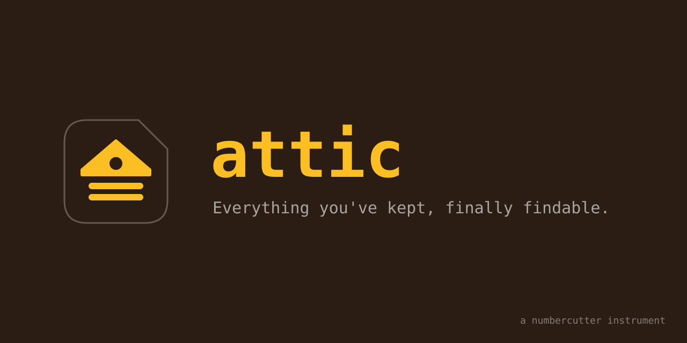

<p align="center"></p>

**Everything you've kept, finally findable.**

attic turns a folder of notes, transcripts and media into one local, searchable memory. It reads Markdown, text, JSON and subtitle files, files photos, audio and video by name and date, and keeps everything in a single SQLite file on your machine.

## Quick start

Needs [Bun](https://bun.sh) 1.1 or newer. No accounts, no keys, nothing leaves your disk.

```sh
git clone https://github.com/numbercutter/attic && cd attic
bun src/cli.ts index examples/notes --db examples/attic.db
bun src/cli.ts search "lisbon" --db examples/attic.db
bun src/cli.ts on 2025-06-01 --db examples/attic.db
```

To get an `attic` command on your path, run `bun link` in the repo.

## Usage

```sh
attic index ~/notes              # walk a folder; re-run any time
attic search "rounding bug"      # ranked matches with highlighted snippets
attic search "garden*" --limit 5 # trailing * matches a prefix
attic on 2025-06-01              # everything from that day
attic recent 20                  # newest 20 entries
attic recent --db ./work.db      # any command takes --db
```

The database defaults to `~/.attic/attic.db`. Index as many folders into it as you like.

As a library:

```ts
import { open, index, search } from "@numbercutter/attic";

const db = open("notes.db");
await index(db, "./notes");
for (const hit of search(db, "fig tree")) console.log(hit.path, hit.snippet);
```

## How it works

- **Walk.** Every `.md .txt .json .srt .vtt` file is read as text. Subtitle files lose their cue numbers, timestamps and voice tags; JSON is flattened to its keys and string values. Images, audio and video (`.jpg .png .heic .mp3 .m4a .wav .mp4 .mov` and friends) are indexed by filename, folder and date only.
- **Store.** One `files` table holds path, kind, mtime, size and day. An FTS5 table with the Porter stemmer holds folder, filename and body.
- **Stay current.** A file is re-read only when its mtime or size changed. Files that vanished from the folder are dropped from the index.
- **Rank.** Search uses `bm25` with filename matches weighted above body matches, and shows the best snippet from whichever column matched.
- **Date.** A file's day comes from a `YYYY-MM-DD` (or `YYYYMMDD`) in its filename, then a `date:` line in Markdown front matter, then its modification time.

## Limits

- No OCR, speech-to-text or EXIF. A photo is findable only by what its name and folder say.
- Search is keyword search with stemming, not semantic. "car" will not find "vehicle".
- Text files are read whole into memory; very large logs will be slow.
- PDFs, Word files and email archives are skipped.
- Dates from mtime follow your machine's local time zone, and copying files can reset mtime.
- Removing a folder from disk removes it from the index only when you re-run `attic index` on its parent.

<sub>A numbercutter instrument · MIT</sub>
